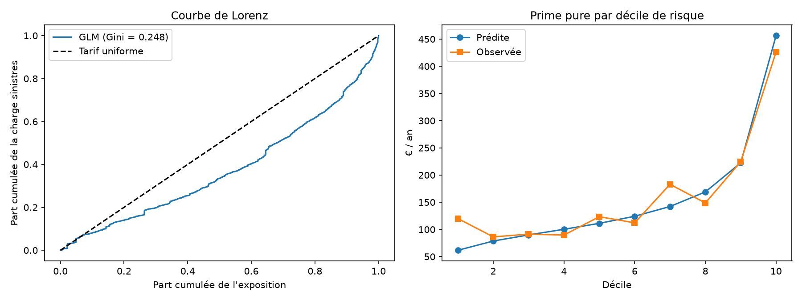
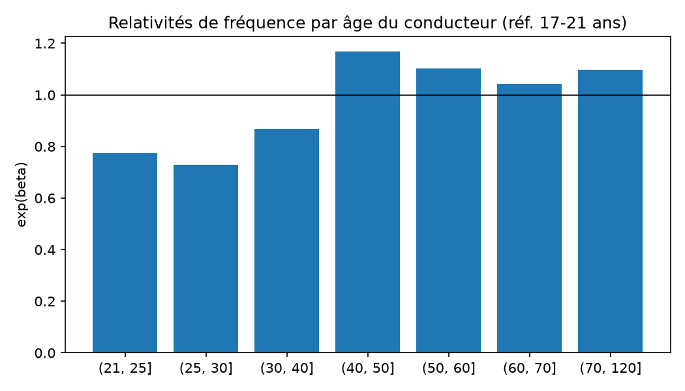

# Tarification auto par GLM : fréquence × coût moyen

Construction d'une **prime pure** en assurance automobile (responsabilité civile) sur le jeu de données public **freMTPL2**, 678 000 contrats d'un assureur français, avec des **modèles linéaires généralisés (GLM)**. C'est la méthode standard de la tarification non-vie.

## Objectif

Estimer, pour chaque assuré, le coût annuel attendu de ses sinistres :

$$\text{Prime pure} = \underbrace{E[N]}_{\text{fréquence}} \times \underbrace{E[Y]}_{\text{coût moyen}}$$

- **Fréquence** : GLM **Poisson**, lien log, avec l'exposition (durée de couverture) prise en compte.
- **Coût moyen** : GLM **Gamma**, lien log, ajusté sur les contrats sinistrés.

## Données

| Variable | Description |
|---|---|
| `Exposure` | Durée de couverture (en années, ≤ 1) |
| `ClaimNb` | Nombre de sinistres |
| `ClaimAmount` | Montant des sinistres (table freMTPL2sev) |
| `DrivAge`, `VehAge`, `VehPower`, `VehBrand`, `VehGas` | Caractéristiques du conducteur et du véhicule |
| `BonusMalus` | Coefficient de réduction-majoration (50 à 350) |
| `Area`, `Density`, `Region` | Zone géographique et densité de population |

Les données sont téléchargées automatiquement depuis OpenML (identifiants 41214 et 41215).

## Démarche

1. **Nettoyage** (`src/data.py`) : exposition plafonnée à 1 an et nombre de sinistres plafonné à 4, ce qui corrige des erreurs de saisie probables. Les montants sont écrêtés à 200 k€, car les sinistres graves sont normalement tarifés à part par une surcharge. Les montants sont ensuite rattachés aux contrats.
2. **Variables tarifaires** (`src/features.py`) : l'âge du conducteur, l'âge du véhicule et la puissance sont regroupés en classes, comme dans une grille tarifaire réelle. Le bonus-malus est plafonné à 150 et la densité passée en logarithme.
3. **Modélisation** (`src/models.py`) :
   - GLM Poisson sur `ClaimNb / Exposure`, pondéré par l'exposition (équivalent à un offset `log(Exposure)`) ;
   - GLM Gamma sur le coût moyen `ClaimAmount / ClaimNb`, pondéré par le nombre de sinistres ;
   - légère pénalisation L2 pour stabiliser les modalités peu représentées.
4. **Validation** sur un échantillon test (20 %) :
   - **déviance de Poisson**, comparée au modèle nul (fréquence moyenne pour tous) ;
   - **indice de Gini et courbe de Lorenz** : capacité du tarif à classer les risques ;
   - **lift par décile** : prime pure prédite comparée à la prime pure observée ;
   - **équilibre global** : charge prédite rapportée à la charge observée.
5. **Lecture tarifaire** : les **relativités** `exp(β)` donnent le coefficient multiplicateur de chaque modalité par rapport à la modalité de référence.

## Résultats

<!-- RESULTATS:DEBUT -->
*Résultats obtenus sur freMTPL2 (échantillon test de 133,780 contrats).*

| Indicateur | Valeur |
|---|---|
| Contrats | 668,897 |
| Exposition totale | 353,755 années |
| Fréquence observée | 7.46% par an |
| Coût moyen observé | 1,977 € |
| Prime pure moyenne observée | 147.6 € / an |
| Déviance de Poisson test : modèle nul → GLM | 0.4850 → 0.4636 |
| Indice de Gini de la prime pure (test) | 0.248 |
| Charge prédite / charge observée (test) | 0.960 |

**Prime pure par décile de risque (test)**

| Décile | Exposition | Prime pure prédite (€) | Prime pure observée (€) |
|---|---|---|---|
| 1 | 7,442 | 61.7 | 119.9 |
| 2 | 7,620 | 78.7 | 86.3 |
| 3 | 7,674 | 89.9 | 91.3 |
| 4 | 7,638 | 100.2 | 89.7 |
| 5 | 7,534 | 111.2 | 123.4 |
| 6 | 7,317 | 124.2 | 112.1 |
| 7 | 7,173 | 142.1 | 183.0 |
| 8 | 6,856 | 169.0 | 148.7 |
| 9 | 6,167 | 222.4 | 224.4 |
| 10 | 5,489 | 456.4 | 426.3 |

**Principales relativités du modèle de fréquence**

| Variable | Relativité exp(β) |
|---|---|
| BonusMalus | 1.542 |
| DrivAgeBand_(25, 30] | 0.730 |
| VehAgeBand_(15, 200] | 0.741 |
| DrivAgeBand_(21, 25] | 0.775 |
| VehBrand_B12 | 0.798 |
| Region_R82 | 1.199 |
| VehBrand_B11 | 1.181 |
| Region_R73 | 0.825 |




<!-- RESULTATS:FIN -->

**Lecture :** une relativité de 1,30 signifie une fréquence de sinistres 30 % plus élevée que la modalité de référence, toutes choses égales par ailleurs. Le Gini mesure la capacité du tarif à séparer les bons et les mauvais risques (0 = tarif uniforme).

Le projet est exécuté automatiquement par GitHub Actions (`.github/workflows/run.yml`) : à chaque modification, le modèle est réentraîné sur freMTPL2 et cette section est mise à jour.

## Lancer le projet

```bash
pip install -r requirements.txt
python main.py          # données réelles freMTPL2
python main.py --demo   # données synthétiques, sans connexion internet
```

Le script crée dans `outputs/` :
- `relativites_frequence.csv` : coefficients et relativités du GLM fréquence ;
- `lift_deciles.csv` : prime pure prédite et observée par décile de risque ;
- `performance.png` : courbe de Lorenz et graphique de lift ;
- `relativites_age.png` : relativités par classe d'âge du conducteur.

## Pistes d'amélioration

- Comparer avec un modèle **Tweedie** (prime pure modélisée directement) et un **gradient boosting** (LightGBM), en se servant du GLM comme référence lisible.
- Lisser le zonage géographique (régions, densité).
- Modéliser les sinistres graves à part (loi de Pareto au-delà d'un seuil) et calculer une surcharge.
- Passer de la prime pure à la prime commerciale : chargements de frais, marge, taxes.

## Outils

Python · pandas · scikit-learn · matplotlib

---
*Auteur : Mohammed Bahri, Master ISIFAR (Finance, Assurance et Risque), Université Paris Cité.*
